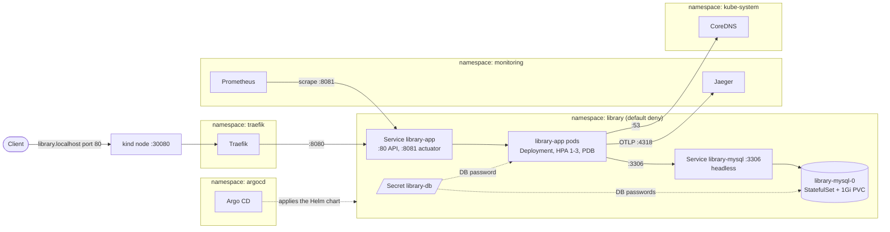
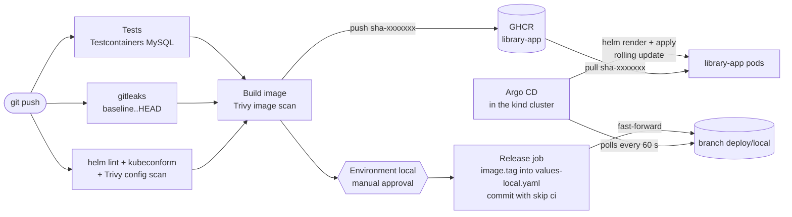
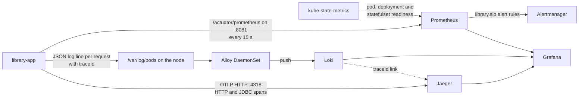

# Architecture

## System overview

```
git push ─► GitHub Actions CI ─► image ghcr.io/neeldholiya04/library-app:sha-<commit>
            tests · gitleaks · helm lint ·        │
            kubeconform · Trivy (chart + image)   │ release job waits for a person to approve
                                                  ▼
                           bot writes the new image tag into values-local.yaml
                           and moves the branch deploy/local forward
                                                  │
┌─────────────── kind cluster (one node, on the laptop) ───────────────┐
│ Argo CD watches deploy/local ─► renders the Helm chart ─► applies it │
│                                                                      │
│ http://library.localhost ─► Traefik ─► library-app (1-3 pods)        │
│                                          │  port 8081: health+metrics│
│                                          ▼                           │
│                              library-mysql (1 pod + 1Gi disk)        │
│                                                                      │
│ monitoring: Prometheus · Alertmanager · Grafana · Loki · Alloy ·     │
│             Jaeger                                                   │
└──────────────────────────────────────────────────────────────────────┘
```

## Components

| Component | Runs as | Purpose |
|---|---|---|
| `library-app` | Deployment, HPA 2–4 replicas (local 1–3), PDB `minAvailable: 1` | Spring Boot 3.5 / Java 21 REST API. Port 8080 serves the API, 8081 serves actuator (health, info, Prometheus) and is never exposed through the Ingress |
| `library-mysql` | StatefulSet, 1 replica, 1 Gi PVC, headless Service | MySQL 8.4. Schema owned by Flyway (`V1__init.sql`); Hibernate only validates |
| Traefik | Deployment in `traefik`, NodePort 30080 mapped to host port 80 by kind | Ingress controller for `library.localhost` |
| Argo CD | `argocd` namespace | Pulls `charts/library` from the `deploy/local` release branch and keeps the cluster equal to git |
| kube-prometheus-stack | `monitoring` (release `monitoring`) | Prometheus, Alertmanager, Grafana, kube-state-metrics. Kubelet, node-exporter and control-plane scraping, default rules and admission webhooks disabled to fit a laptop. Alertmanager has no notification receiver configured (alerts are visible in Prometheus, Alertmanager and Grafana) |
| Loki + Alloy | `monitoring` | Alloy (DaemonSet) tails `/var/log/pods` for the `library` namespace and pushes to single-binary Loki |
| Jaeger | `monitoring` | All-in-one, in-memory. Receives OTLP traces on 4318 |

Namespaces: `library` (workload), `monitoring` (observability), `argocd` (delivery), `traefik` (edge).

## Runtime and network

Solid arrows are the only traffic the NetworkPolicies allow into or out of `library`; everything else is denied by `library-default-deny`.



## Request flow

```
client ──► localhost:80 ──► kind node :30080 ──► Traefik ──► Service library-app:80
       ──► pod :8080 ──► HikariCP ──► Service library-mysql:3306 ──► mysql-0 (PVC)
```

- Traefik routes `Host: library.localhost` to the Service. The Service only lists pods whose readiness probe passes.
- Readiness = `readinessState` + `db`, so a pod that cannot reach MySQL leaves the Service instead of returning errors.
- Every request produces a Micrometer metric, one JSON (ECS) log line (method, path, status, duration, `traceId`) from `RequestLoggingFilter`, and an OTLP span with child spans for each SQL query. Grafana links the log line's `traceId` to the trace in Jaeger.

## Commit to running pod

```
push ──► CI: tests (Testcontainers MySQL) · gitleaks · helm lint + kubeconform + Trivy config
     ──► image build ──► Trivy image scan ──► push ghcr.io/neeldholiya04/library-app:sha-<7>
     ──► deploy job (GitHub Environment "local", manual approval)
          writes image.tag into values-local.yaml, commits "deploy: ... [skip ci]",
          pushes the branch and fast-forwards deploy/local
     ──► Argo CD (polls every 60 s) syncs deploy/local ──► rolling update
```



- GitHub runners cannot reach a laptop cluster, so delivery is pull-based (Argo CD) rather than push-based (`helm upgrade` from CI).
- Only the approved job moves `deploy/local`, so code, config and image changes are all gated by the same approval.
- Traceability: commit SHA = image tag = pod label `app.kubernetes.io/version` = `/actuator/info` `git-sha`.

## Release control

- **Strategy:** rolling update, `maxSurge: 1`, `maxUnavailable: 0`, readiness-gated. Old pods serve until new ones are ready.
- **Rollback:** move the release pointer back, `git push --force origin <previous-release-commit>:deploy/local`. No rebuild; the old image is already in GHCR.
- **Drift:** Argo CD `selfHeal: true` reverts manual `kubectl` changes; `prune: true` removes resources deleted from git.

## Observability data flow



## Health definition (SLOs)

| SLO | Target | Alert |
|---|---|---|
| Availability | ≥ 99% of non-actuator requests are not 5xx | `LibraryHighErrorRate` (> 5% for 5 m) |
| Latency | p95 < 300 ms | `LibraryHighLatency` (10 m) |
| Capacity | ≥ 1 ready app pod | `LibraryAppUnavailable` (2 m) |
| Dependency | MySQL ready | `LibraryDatabaseDown` (2 m) |
| Stability | no restart loops | `LibraryPodRestarting` (> 3 in 15 m) |

Recovery is verified when the alert resolves, the Service has ready endpoints again and `scripts/journey.sh` passes.

## Failure boundaries

| Failure | Effect | Recovery |
|---|---|---|
| MySQL down | App readiness fails, pods leave the Service, Traefik returns 503; liveness stays up so pods are not restarted | StatefulSet restarts MySQL on the same PVC; readiness returns without restarting the app |
| One app pod crashes | With the default values (2+ replicas) the other replica keeps serving and the PDB blocks voluntary eviction of the last pod. Locally the HPA minimum is 1, so the API is unavailable until the pod restarts | Deployment replaces the pod |
| Bad release | New pods never become ready; `maxUnavailable: 0` keeps old pods serving | Move `deploy/local` back |
| Argo CD down | No new deploys; running workload unaffected | Restart Argo CD; it resyncs from git |
| Monitoring down | Workload unaffected; span export is asynchronous | Reinstall from `deploy/platform` values |
| Traefik down | No external access; in-cluster traffic unaffected | Deployment restarts it |

## Security

- **Secrets:** DB and Grafana credentials are random values created in the cluster by `deploy/bootstrap-local.sh`; nothing secret is in git. The app reads the DB password from a Secret, all other config from a ConfigMap.
- **Pods:** app and MySQL run non-root with a read-only root filesystem, all capabilities dropped, `RuntimeDefault` seccomp, no service account token.
- **Network:** default-deny NetworkPolicy in `library`. App accepts traffic only from `traefik` (8080) and `monitoring` (8081); MySQL accepts only the app on 3306; app egress is limited to MySQL, DNS and Jaeger.
- **Exposure:** only the Ingress is reachable from outside; actuator and MySQL are cluster-internal.
- **Supply chain:** pinned action SHAs, least-privilege workflow `permissions`, gitleaks, Trivy image and chart scans that fail on HIGH/CRITICAL, Dependabot for Maven, Docker and Actions. Accepted CVEs are listed with reasons and expiry dates in `.trivyignore.yaml`.
- **Image:** multi-stage build, JRE only, non-root UID 10001, curl removed.
