# Verification and operational evidence

All runs are on the local kind cluster built with `deploy/bootstrap-local.sh`. Re-run any of them with the scripts in `scripts/`. Raw outputs are in [`evidence/`](evidence/).

## Tested version

| Item | Value |
|---|---|
| Source commit | `608c03c` |
| CI run | [actions/runs/38700781542](https://github.com/neeldholiya04/Library-Management-System/actions/runs/38700781542) |
| Image | `ghcr.io/neeldholiya04/library-app:sha-608c03c` |
| Release commit on `deploy/local` | `7d07395` |
| Argo CD | `Synced` / `Healthy` at `7d07395` |
| `/actuator/info` | `{"app":{"version":"0.1.0","git-sha":"608c03c"}}` |

## 1. Commit to running pod

`scripts/trace-release.sh` ([raw](evidence/trace-release.txt)):

```
deploy/local commit : 7d07395 deploy: library-app sha-608c03c [skip ci]
image tag in git    : sha-608c03c
source commit       : 608c03c Verification scripts: user journey through the Ingress, release traceability (commit, image, pod, actuator info), MySQL fault-and-recovery demo with alert tracking
CI checks for commit: https://github.com/neeldholiya04/Library-Management-System/commit/608c03c/checks
argo sync revision  : 7d07395 Synced/Healthy
running pods        :
  POD                          IMAGE                                           VERSION
library-app-5d44ddbdbb-2vw76   ghcr.io/neeldholiya04/library-app:sha-608c03c   sha-608c03c
/actuator/info      : {"app":{"version":"0.1.0","git-sha":"608c03c"}}
```

The same SHA appears in git, the image tag, the pod label and the running application, so the running version traces back to one commit and one CI run.

## 2. Pipeline run for that commit

[Run 38700781542](https://github.com/neeldholiya04/Library-Management-System/actions/runs/38700781542), all jobs green:

| Job | Result | Duration |
|---|---|---|
| Tests (unit + Testcontainers MySQL) | success | 42 s |
| Secret scan (gitleaks, `baseline..HEAD`) | success | 12 s |
| Helm lint + kubeconform + Trivy chart config scan | success | 12 s |
| Build, Trivy image scan, push to GHCR | success | 97 s |
| Release (approval gate on environment `local`, then bump `deploy/local`) | success after manual approval | 6 s |

The release job only starts after a reviewer approves the `local` environment, so every change to the cluster (image, chart or config) is approved before Argo CD can see it.

## 3. Working request (user journey)

`scripts/journey.sh` through the Ingress at `http://library.localhost` ([raw](evidence/journey.txt)):

```
POST   /author                              200
POST   /book                                200
GET    /book/title/Book-1792051085          200
POST   /patron                              200
POST   /lending                             200
GET    /lending/patron/7                    200
PUT    /lending/7                           200
GET    /lending/7                           200
journey ok: author=8 book=7 patron=7 lending=7
```

The script exits non-zero on any non-2xx response and checks that the lending moves from `BORROWED` to `RETURNED`.

## 4. Metrics, logs and traces for the same request

Captured on 2026-10-15:

- **Metrics:** Prometheus target `serviceMonitor/library/library-app/0` is `up`; `http_server_requests_seconds_count` is broken down by `uri` and `status`; p95 latency 15 ms against the 300 ms SLO.
- **Logs:** each API request writes one ECS JSON line with `traceId` and `spanId`, for example `GET /lending/4 200 18ms`, found in Loki with `{namespace="library"} |= "<traceId>"`.
- **Traces:** the same trace ID in Jaeger has 8 spans: `http get /lending/{id}` with JDBC `connection`, `query` and `result-set` child spans.
- **Grafana:** the Prometheus, Loki and Jaeger data sources pass their health checks; the "Library – Service Overview" dashboard is loaded from the chart.

`scripts/check-observability.sh` re-checks all of these connections (Prometheus scraping, rules, Alertmanager, Grafana data sources, dashboard, Loki logs, traces, and a log trace ID opening in Jaeger) and prints PASS or FAIL for each.

## 5. Runtime state

From [`cluster-state.txt`](evidence/cluster-state.txt):

- `library-app` 1/1 and `library-mysql-0` 1/1 Running, HPA at 2% of target (min 1, max 3 locally).
- NetworkPolicies active: `library-default-deny`, `library-app`, `library-mysql`.
- Argo CD application `library`: `Synced` / `Healthy`.
- Prometheus: 8 targets, all `up`, including `serviceMonitor/library/library-app/0`.

## 6. Fault and recovery: MySQL outage

`scripts/fault-demo.sh` ([raw](evidence/fault-demo.txt)). Argo CD auto-sync is paused during the fault so self-heal does not undo it, then re-enabled to perform the recovery.

| Time | HTTP `/author` | Ready app endpoints | Alerts |
|---|---|---|---|
| 13:28:28 | 200 | 1 | none (baseline) |
| 13:28:29 | 500 | 1 | MySQL scaled to 0 |
| 13:28:49 | 000 | 0 | readiness failed, pod removed from the Service |
| 13:29:05 | 503 | 0 | Traefik has no ready backend |
| 13:29:37 | 503 | 0 | `LibraryAppUnavailable`, `LibraryDatabaseDown` pending |
| 13:31:42 | 503 | 0 | both **firing**; recovery started (auto-sync re-enabled) |
| 13:32:04 | 200 | 1 | Argo restored MySQL from git, app ready again |
| 13:32:51 | 200 | 1 | `LibraryAppUnavailable`, `LibraryDatabaseDown` resolved |

After recovery the full user journey passed again with new rows (`journey ok: author=9 book=8 patron=8 lending=8`), which also shows the data written before the outage survived on the PVC.

- **Symptom:** requests fail, app endpoints drop to zero.
- **Hypothesis:** the database is unavailable, so readiness (which includes the `db` check) fails.
- **Evidence:** `LibraryDatabaseDown` and `LibraryAppUnavailable` fire after their 2-minute `for` window; ready endpoints go to 0 while the app pod is not restarted, because liveness does not depend on the database.
- **Change:** re-enable Argo CD auto-sync; it restores the StatefulSet to the replica count in git.
- **Verification:** HTTP 200 and 1 ready endpoint 22 seconds after recovery started, alerts resolve, user journey passes.

Observations:

- One request returned `500` in the first second of the outage, before three failed readiness checks (5 s period) removed the pod from the Service; after that Traefik returned `503` instead of the app returning errors.
- `LibraryHighErrorRate` and `LibraryHighLatency` went to `pending` but did not fire, because their `for` windows (5 and 10 minutes) are longer than the 3-minute outage. They guard against sustained degradation; the availability alerts react within 2 minutes.
- Alerts resolved about 45 seconds after recovery: the kube-state-metrics scrape interval plus the 30 s rule evaluation interval.

## 7. Release control

| Demo | Result |
|---|---|
| Rollback (2026-10-14) | Moved `deploy/local` back to the previous release; pods rolled to `sha-0f1820a` in 156 s, `/author` stayed 200 throughout (`maxUnavailable: 0`) |
| Roll forward (2026-10-14) | Moved `deploy/local` forward; pods back on `sha-a8fef02` in 188 s |
| Drift (2026-10-14) | HPA `maxReplicas` patched by hand to 2; Argo self-heal restored the git value 3 in about 10 s |
| Drift (2026-10-15) | A manually set test image was replaced by the git-defined `sha-dba7719` within seconds of auto-sync being re-enabled |

## 8. Security checks

| Check | Result |
|---|---|
| NetworkPolicy: pod in `default` → app | blocked |
| NetworkPolicy: unlabelled pod in `library` → MySQL 3306 | blocked |
| NetworkPolicy: `monitoring` → app 8081 | allowed (`UP`) |
| NetworkPolicy: Ingress → app | allowed (journey above) |
| Trivy image scan in every CI run | 0 fixable HIGH/CRITICAL (curl removed for CVE-2026-92392; accepted CVEs listed with expiry dates in `.trivyignore.yaml`) |
| Trivy chart config scan | 0 HIGH/CRITICAL; MySQL non-root with read-only root filesystem |
| gitleaks over every commit since baseline | clean |
| Secrets in git | none; generated in-cluster by `deploy/bootstrap-local.sh` |

## 9. Incidents on the laptop cluster

These happened during development and shaped the final configuration:

| Incident | Cause | Fix |
|---|---|---|
| App pods stuck at 0/1 with the HPA pinned at max | CPU request (100m) below idle JVM usage, simultaneous JVM starts and a 150 s startup window on a shared 6-vCPU node | CPU request 250m, 300 s startup window, HPA scale-up stabilisation, JVM `ActiveProcessorCount`, probe timeouts |
| MySQL OOM-killed at 512Mi | `performance_schema` defaults | `--performance-schema=OFF`, 640Mi limit, TCP probes instead of `exec` |
| Control plane crash-looping after installing monitoring | kubelet/cAdvisor scraping, operator webhooks and log streaming through the API server on an 8 GB laptop | kube-prometheus-stack without kubelet scraping or admission webhooks, Alloy reads log files from the node, Argo CD resource inclusions, Grafana sidecar scoped to `library` |
| Grafana restarting, dashboards showing "Could not load plugin" | OOM-killed at a 256Mi limit when the browser loaded the data source plugins; at 512Mi it still used 452Mi after two pages | 384Mi request, 768Mi limit |
| Argo CD could not restore MySQL after the fault demo | CoreDNS timed out on Docker Desktop's resolver, so Argo CD could not reach github.com and self-heal stalled | Scaled MySQL back to the replica count in git by hand, restarted CoreDNS; Argo CD then synced. Self-heal depends on reaching git |

## 10. Screenshots

Captured on 2026-10-18 against the running release `sha-769be07` (`deploy/local` at `7099d75`).

| Screenshot | Shows |
|---|---|
| 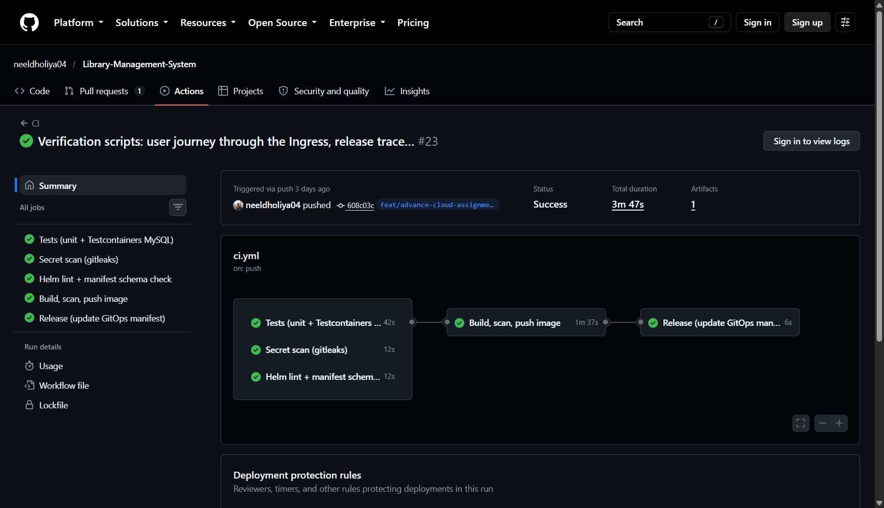 | CI run with all jobs green: tests, gitleaks, chart checks, image build and scan, Release |
| 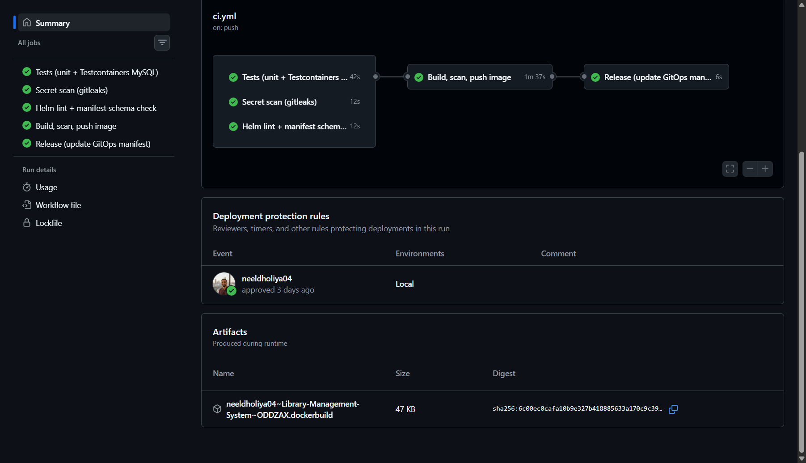 | Deployment protection rule: the `Local` environment approved before the Release job ran |
| 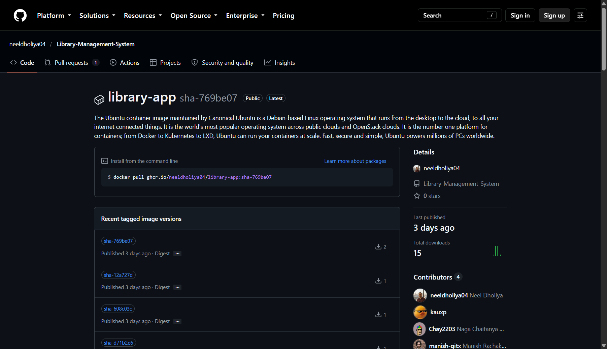 | Image in GHCR, one tag per released commit (`sha-769be07`, `sha-12a727d`, `sha-608c03c`, ...) |
| 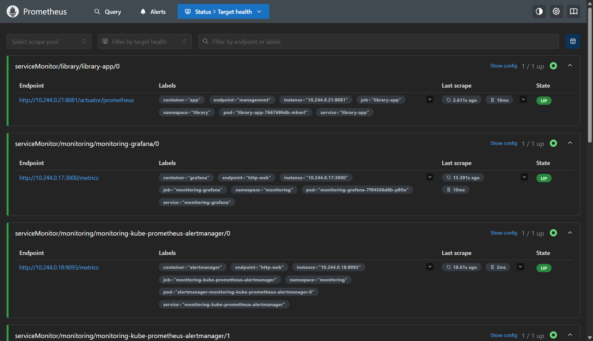 | `serviceMonitor/library/library-app/0` scraping `/actuator/prometheus` on 8081, state `UP` |
| 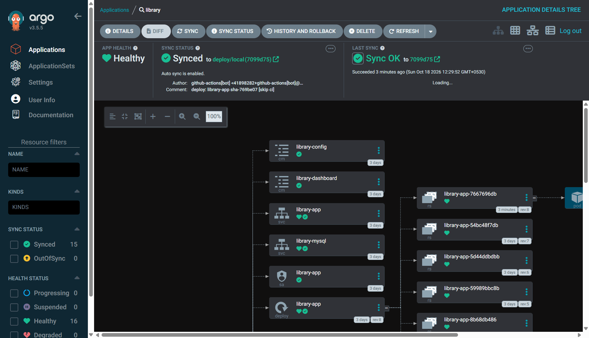 | Application `library` `Synced` to `deploy/local (7099d75)` and `Healthy`, auto sync enabled, every chart resource listed |
| 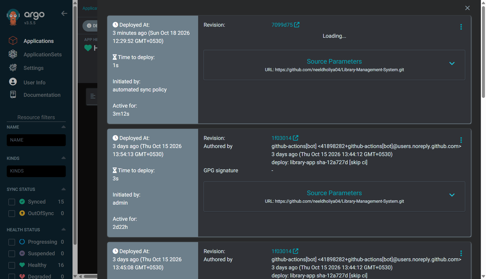 | Release history: each sync tied to a `deploy:` commit, including a manual sync by `admin` |
| 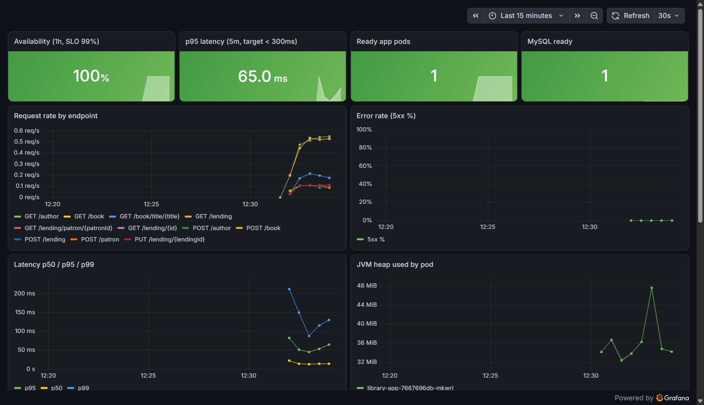 | Dashboard under steady traffic: availability 100%, p95 65 ms, 1 ready pod, MySQL ready, request rate per endpoint, latency percentiles, JVM heap |
| 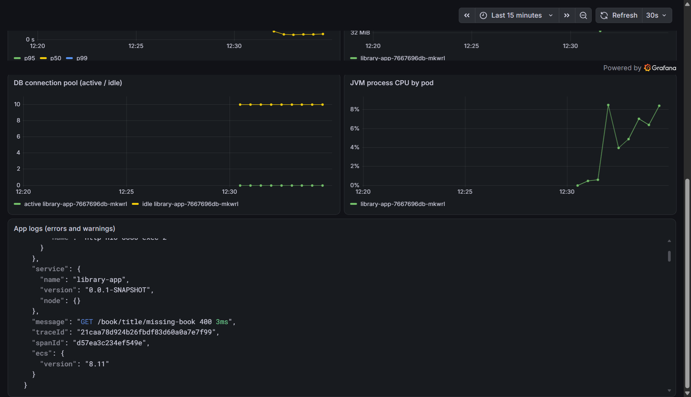 | DB connection pool, JVM CPU and the warning log panel with `traceId` (a `400` for a missing book) |
| 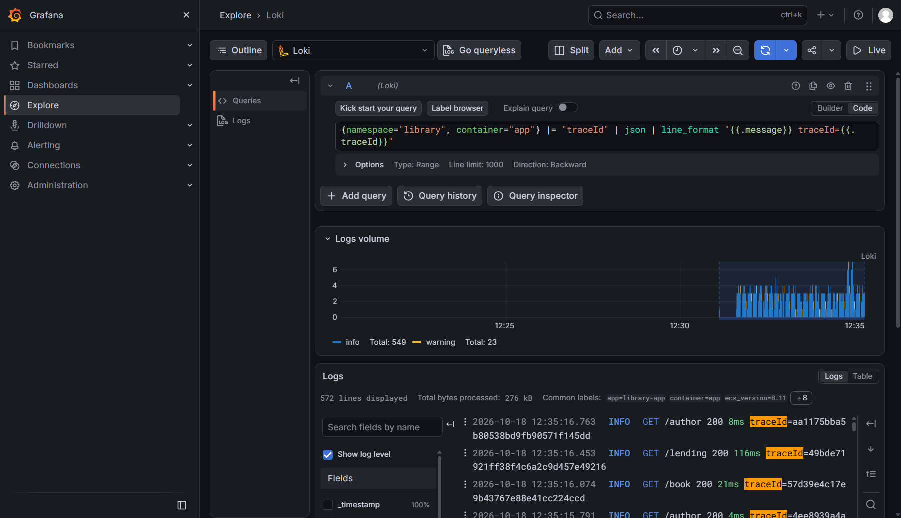 | Loki in Grafana Explore: one line per request with method, path, status, duration and `traceId` |
| 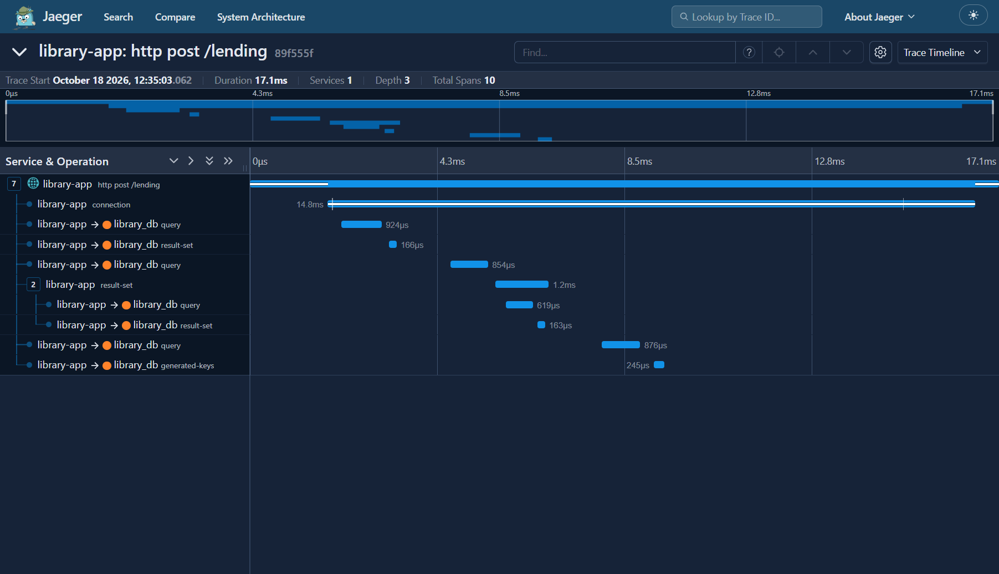 | Trace for `POST /lending`: 10 spans, the HTTP span with JDBC `connection`, `query`, `result-set` and `generated-keys` child spans |
|  | The five `library.slo` rules, all inactive before the fault |
| 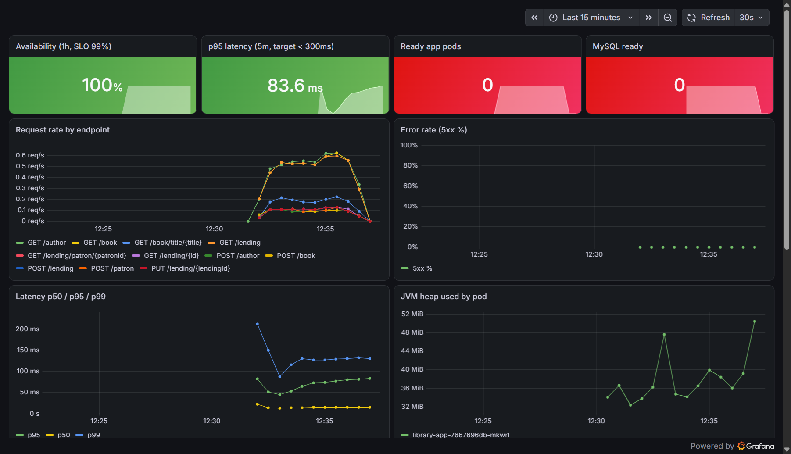 | During the MySQL outage: ready app pods 0, MySQL ready 0, request rate falling to zero |
| 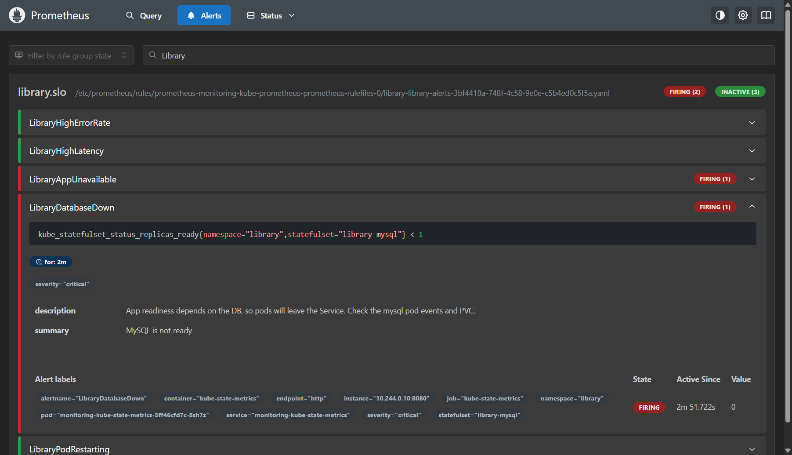 | `LibraryAppUnavailable` and `LibraryDatabaseDown` firing, with the rule expression, `for: 2m`, severity and runbook text |
| 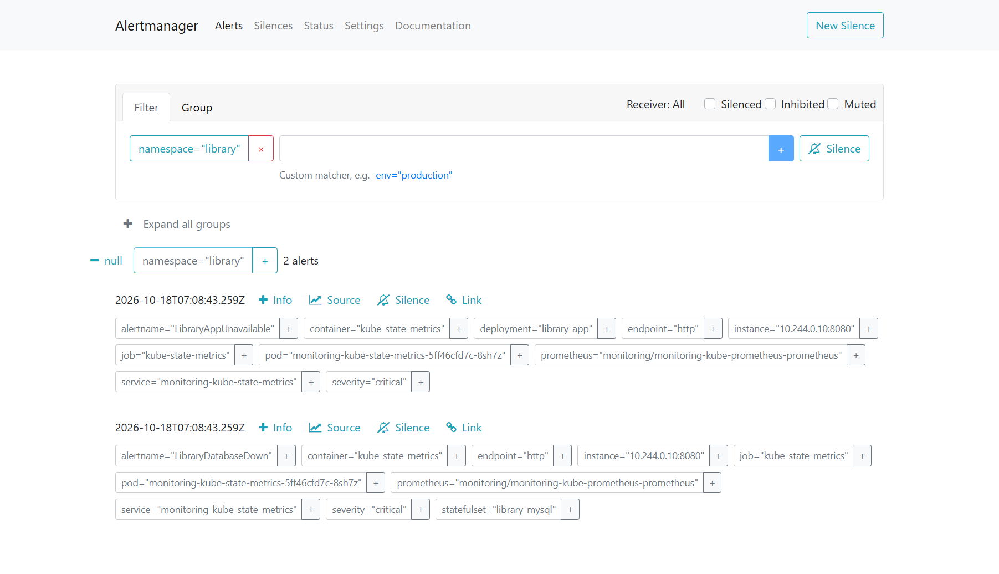 | The same two critical alerts received by Alertmanager |
| 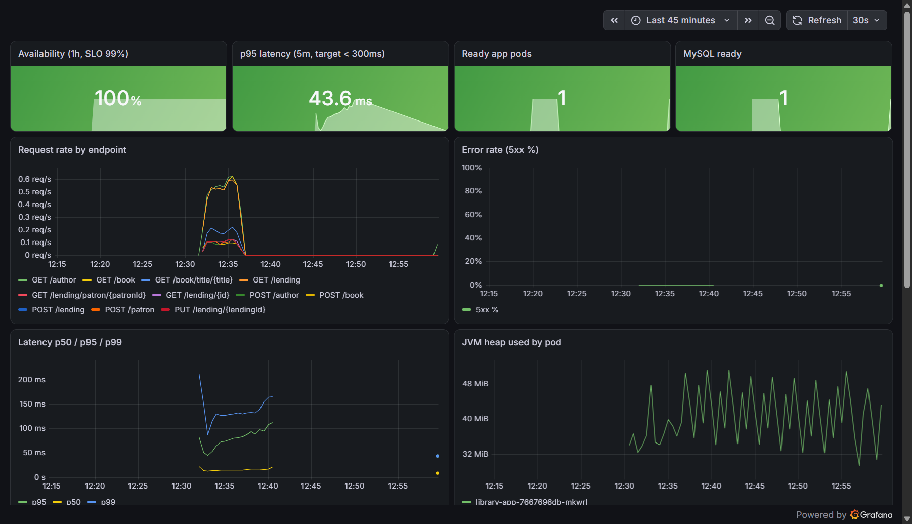 | After recovery: the outage gap in the request rate and readiness, then traffic and readiness back |
| 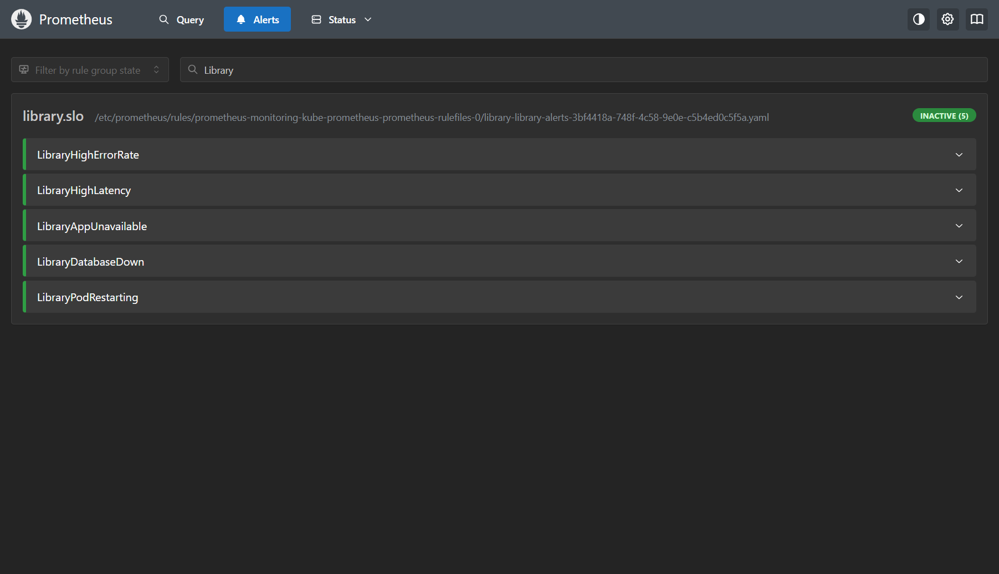 | All five rules inactive again after recovery |

## Limitations of this evidence

- Single-node local cluster; no node failure or multi-replica database scenario.
- Traces are kept in Jaeger's in-memory store and are lost on restart.
- Times in the raw outputs are local time (IST); times on GitHub are UTC.
